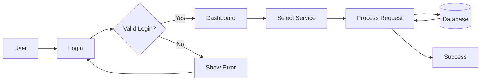
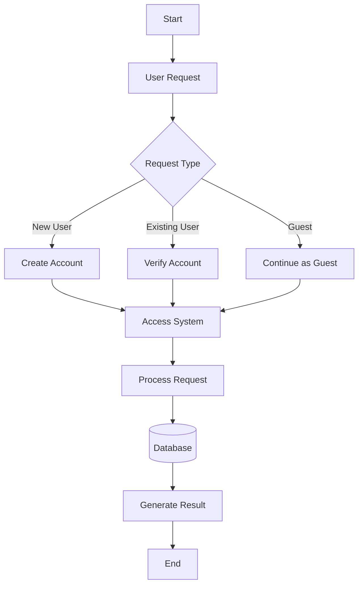

# Quick Start

## follow the steps given below to setup:-

> small steps are always better than standing still.
>
> small progress is always better than no progress.


Just take small steps that it




### installation

install all neccesary libraries required



### authentication

authenticate all the apus befoire useing



### Port Connection

1. choose and set a port for local host testing&#x20;
2. and also add an alteranet port if first is busy



### Api building

Building all the apis&#x20;







